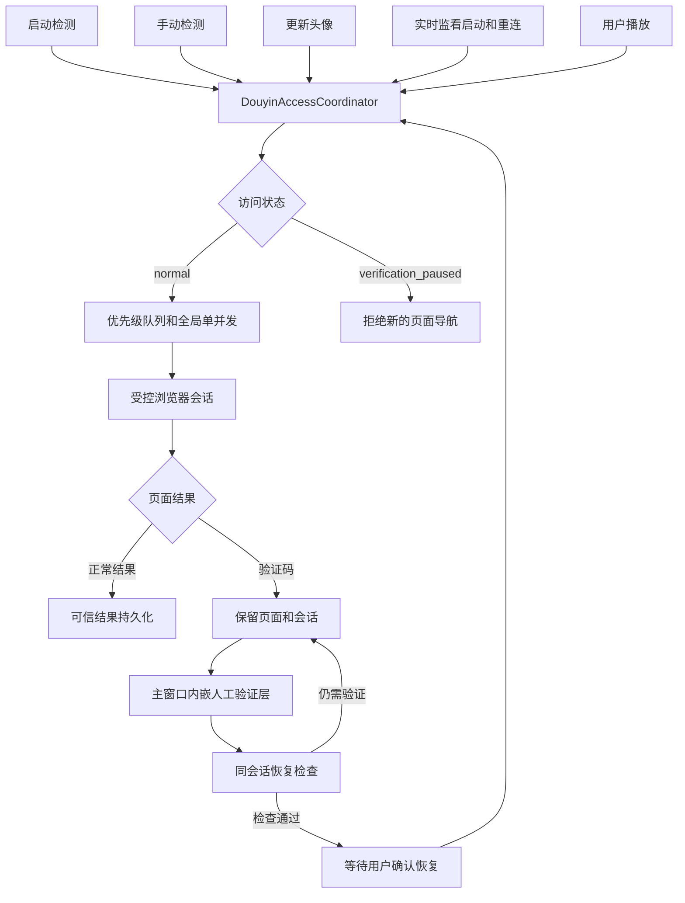

# 抖音访问协调与人工验证恢复设计

## 1. 背景与目标

当前应用存在预备直播间检测、手动检测、头像更新、实时监看启动/重连和播放器加载等多个抖音页面访问入口。现有未提交变更已经把预备直播间检测收紧为串行启动检测，并增加单房间 60 秒手动冷却和验证码识别，但这些保护尚未覆盖其他访问入口。

第一阶段目标是建立统一的抖音访问协调边界：减少重复和并发页面加载；检测到平台安全验证时立即停止新的后台访问；让用户在触发验证的同一浏览器会话中亲自完成验证；并确保验证码、超时和技术错误不会污染最后可信资料、直播场次和后续卡片统计。

## 2. 范围

### 2.1 本阶段包含

- 新增统一的 `DouyinAccessCoordinator`。
- 启动检测、手动检测、头像更新、实时监看启动及重连接入协调器。
- 后台页面加载全局单并发，并支持任务优先级、去重、冷却和退避。
- 检测到 `verification_required` 后进入持久的全局验证保护状态。
- 保留触发验证的浏览器会话，向用户显示可交互的主窗口内嵌验证页。
- 用户完成平台验证后，在同一会话中检查验证是否已经解除，再由用户确认恢复。
- 区分本次检测状态与最后可信数据，修正错误状态导致的指标丢失或虚假停播。
- 删除或替换已经失效的“预备直播间检测频率”设置。
- 提供诊断记录和自动化测试。

### 2.2 本阶段不包含

- 不自动识别、点击、代答或绕过验证码。
- 不在验证码页面执行指标采集、截图或用户输入读取。
- 不实现新的直播间卡片、详情抽屉、热度标签或历史图表。
- 不改变头像“默认只获取一次、以后仅由用户手动更新”的产品规则。
- 不自动补跑验证码出现前已经取消的旧队列。
- 不把持久浏览器会话、Cookie 或登录信息纳入普通数据备份。

## 3. 核心原则

1. 所有可能产生抖音页面导航的入口必须通过同一个协调器。
2. 页面内已有 DOM 和视频状态检查不属于新导航，不进入页面加载队列。
3. 卡片、排序、详情和统计只消费本地数据库，不得隐式触发页面加载。
4. 只有可信的 `live` 或 `offline` 结果能够改变直播业务事实。
5. `verification_required`、`timeout`、`page_error` 和 `login_required` 表示本次采集不可用，不等价于停播。
6. 验证码恢复必须由用户主动完成和确认，软件不得自动解除保护。

## 4. 总体架构

## 5. 组件职责

### 5.1 `DouyinAccessCoordinator`

负责：

- 维护全局状态：`normal`、`verification_paused`、`recovery_checking`、`recovery_ready`、`stopped`。
- 接收所有页面导航任务，统一排队和去重。
- 保证后台任务全局最多一个正在启动页面。
- 在验证码状态下拒绝新的检测、头像更新、自动重连和播放器导航。
- 检测到验证码后清空尚未开始的后台队列。
- 保留触发验证的任务上下文、页面和会话。
- 发布状态变化给主进程和渲染进程。
- 关闭应用时安全释放内嵌视图并清理内存队列。

协调器不负责解析直播指标、写数据库或管理 ASR；这些职责继续由现有探测、会话和持久化组件承担。

### 5.2 任务类型与优先级

从高到低：

1. `verification_recovery_check`：用户明确要求检查验证结果。
2. `user_play`：用户明确点击播放。
3. `manual_probe`：用户明确点击检测。
4. `avatar_refresh`：用户明确点击更新头像。
5. `monitor_reconnect`：实时监看自动重连。
6. `startup_probe`：启动时预备直播间检测。

高优先级任务不能中断已经开始的页面导航，只能排在等待任务之前。相同房间、相同任务类型不得重复入队。

### 5.3 浏览器会话

- 后台访问使用应用专用的持久 Electron session，使触发验证码的会话能够继续用于人工验证。
- 同一 session 可以支持不同页面载体，但协调器仍限制页面启动并发。
- 内嵌验证视图必须复用触发验证码的持久 session；如果触发页无法转移到视图，则允许在同一 session 中加载一次触发房间页面，但不得并发创建额外检查页。
- 普通成功、离线、超时和页面错误完成后可以关闭任务窗口，但不得每次清空共享 session。
- 本阶段在数据管理页提供“清除抖音会话”操作；该操作必须二次确认，并说明可能重新触发登录或验证。
- session 数据不进入 `.duoduo-backup`，也不由常规数据清理规则自动删除。

### 5.4 内嵌验证视图控制器

独立 `BrowserWindow` 方案已在 Electron 39.8.10 与 macOS 26.5.1 上重复触发主进程原生段错误，因此不再作为验证承载方式。控制器负责把持久会话中的验证页面显示为主窗口内的 `WebContentsView` 覆盖层，并满足以下边界：

- 不创建第二个 macOS 原生窗口，不监听或处理原生窗口关闭事件。
- `WebContentsView` 在验证暂停期间保持附着于主窗口；显示时覆盖主内容区，关闭时设置为不可见并移出可视区域，不销毁 `webContents`。
- 覆盖层顶部由主应用渲染固定工具栏，包含当前域名、人工操作说明、`关闭验证页` 和 `我已完成，检查状态`。
- 主窗口移动、缩放或最大化时同步更新验证视图边界；工具栏区域不得被远端页面覆盖。
- 应用受控退出时先停止导航和恢复检查，再移除视图并关闭 `webContents`。
- 恢复检查必须通过当前视图的 `mainFrame.executeJavaScript` 读取已经渲染的只读页面标记，不得使用会等待整个页面停止加载的 `webContents.executeJavaScript`。抖音页面可能因媒体、长连接或持续请求长期保持 loading，视觉可用不等于 WebContents 已停止加载。
- 页面检查只读取主框架正文中与验证码或登录阻塞有关的有限文本，不读取输入框值、验证码答案、Cookie、键盘事件或网络请求内容。
- 检查不得刷新、停止加载或重新导航当前抖音页面，也不得创建额外窗口或 WebContents。

- 显示当前真实域名和“平台验证由用户操作”的说明。
- 只允许抖音及验证流程实际需要的可信官方域名；非允许域名导航在窗口内阻止，并可交给系统浏览器处理。
- 阻止任意新窗口和非预期下载。
- 不注入自动操作脚本，不读取输入框、验证码答案或用户键盘内容。
- 验证期间不截图、不解析主播资料、不写直播观察记录。
- 用户关闭验证页后继续保持 `verification_paused`，不得自动恢复。

可信域名集合应集中配置并记录被阻止的域名，不能散落在 UI 或探测代码中。

## 6. 验证码状态与恢复流程

### 6.1 进入保护状态

任一受协调任务得到明确的 `verification_required` 后：

1. 将全局状态切换为 `verification_paused`。
2. 保存触发房间、任务类型、时间和持久会话引用。
3. 清空尚未开始的后台任务；取消的任务不得被记为检测失败。
4. 阻止新的页面导航。
5. 保留已有稳定直播监看页面，但禁止其重新加载或重连。
6. UI 顶部持续显示全局警告及触发时间。

### 6.2 用户验证

- 用户点击“打开验证页”后，在主窗口内显示验证覆盖层。
- 若保留视图意外销毁，应用保持暂停并明确提示“原验证会话已丢失”；不得悄悄创建新视图并声称可以恢复。
- 用户亲自完成平台要求的操作。

### 6.3 恢复检查

用户点击“我已完成，检查状态”后：

1. 状态切换为 `recovery_checking`，其他任务仍被拒绝。
2. 在同一内嵌视图和 session 的当前主框架中执行一次只读页面状态检查；检查不能等待整个页面停止加载，也不得创建额外隐藏检查窗口。
3. 检查只判断验证码或登录阻塞是否仍存在，不采集指标、不截图、不产生观察记录。
4. 若仍存在验证，回到 `verification_paused` 并说明原因。
5. 若验证页面消失，进入 `recovery_ready`，但仍不自动恢复后台任务。
6. 用户点击“恢复访问”后状态才回到 `normal`。
7. 检查在 10 秒内无结果时以 `VERIFICATION_CHECK_TIMEOUT` 失败，自动回到 `verification_paused`，显示可重试提示；超时不得被解释为验证已解除。

恢复后不补跑已取消队列。启动检测、头像更新和自动重连必须等待各自下一次合法触发。

## 7. 频率、冷却与退避

### 7.1 手动操作

- 手动检测：同一房间从实际开始导航时起 60 秒冷却。
- 更新头像：同一房间使用独立的 60 秒冷却，并进入统一队列。
- 冷却必须由主进程权威执行；渲染进程倒计时只提供反馈。
- 被全局验证保护拒绝、且尚未开始导航的任务不消耗冷却。

### 7.2 启动检测

- 预备直播间只执行一次启动批次，不周期重排。
- 启动批次串行，并设置单次启动的数量上限；第一版默认最多检测 20 个最近活跃或最近添加的预备直播间。
- 房间之间加入 3 至 8 秒随机间隔；实现通过注入时钟与随机源完成确定性测试。
- 超出上限的房间显示“本次启动未检测”，不自动补跑。

### 7.3 实时监看重连

- 已打开直播页面上的健康检查可以保持秒级，因为它不产生新导航。
- 离线后的页面重连依次使用 1、2、5、10 分钟退避，后续保持 10 分钟。
- 每次重连加入随机抖动，避免多个房间同步导航。
- 技术故障允许有限次数递增退避；达到上限后进入错误状态并停止自动重连。
- 验证保护期间只记录“重连已暂停”，不积压大量待执行任务。

## 8. 可信数据模型

### 8.1 状态分层

业务展示不得只依赖一个混合状态。至少区分：

- `probeStatus`：最近一次尝试的结果，如 `live`、`offline`、`verification_required`、`timeout`、`page_error`。
- `probeCheckedAt`：最近一次尝试发生时间。
- `lastReliableStatus`：最近一次可信的 `live` 或 `offline`。
- `lastReliableStatusAt`：该可信状态采集时间。
- `lastReliableMetrics`：最近一次可信直播指标。
- `metricsObservedAt`：这些指标真正采集时间。

第一阶段在 `room_snapshots` 增加最近尝试与最后可信数据所需字段，并通过现有数据库迁移机制兼容旧数据。历史观察表继续逐次记录采集尝试，但业务展示和直播场次更新只消费可信结果。

### 8.2 持久化规则

- `live`：更新可信状态、可信指标、主播资料和直播封面；缺失字段不能以 0 覆盖旧值。
- `offline`：更新可信状态并用于确认停播，但不使用空白页或通用标题覆盖主播资料。
- `verification_required`：只记录尝试状态、时间和错误；保留所有可信资料及指标。
- `timeout`、`page_error`：只记录尝试状态、时间和错误；保留所有可信资料及指标。
- `login_required`：不等于停播，只记录阻塞状态；停止当前房间的自动重试，但不进入全局验证码保护。用户后续明确触发的操作仍通过协调器执行。
- `checking`：仅为瞬时 UI 状态，不覆盖可信状态或可信指标。

### 8.3 直播场次规则

- 可信 `live` 可以开始或延续直播场次。
- 只有可信 `offline` 可以结束直播场次并记录停播时间。
- `verification_required`、`timeout`、`page_error`、`login_required` 和 `checking` 不得结束场次。
- 若直播期间出现不可用状态，场次暂时保持“结束时间未知”。后续可信 `live` 继续原场次；后续可信 `offline` 再结束场次。
- 第一阶段不推测不可观测区间内的精确停播时间，只保存最后直播证据与首次离线证据，供第二阶段展示时间范围。

## 9. UI 行为

### 9.1 全局验证横幅

横幅持续显示，不能自动消失，内容包括：

- “抖音要求安全验证，新的页面访问已暂停。”
- 触发房间和触发时间。
- “现有可信数据不会被覆盖。”
- `打开验证页`。
- 验证页显示时提供 `关闭验证页`，只关闭覆盖层，不改变访问保护状态。
- `我已完成，检查状态`。
- `继续保持暂停`。

只有进入 `recovery_ready` 后才显示 `恢复访问` 按钮。

### 9.2 操作反馈

- 验证保护期间，检测、更新头像和新播放按钮保持可见但禁用，并说明“完成平台验证后可用”。
- 已经稳定运行的监看页面继续工作；需要重连时显示“验证保护中，已暂停重连”。
- 被取消的启动任务显示“因平台验证未执行”，不能显示为检测失败。
- 删除“预备直播间检测频率”设置，改为只读说明“预备直播间仅在启动时分批检测，也可手动检测”。

## 10. 错误处理与诊断

需要记录但不得包含 Cookie、页面正文、验证码内容或用户输入的事件：

- 任务入队、开始、完成、取消及类型。
- 全局访问状态变化。
- 验证码触发房间、任务类型和时间。
- 内嵌验证页打开、关闭和视图异常销毁。
- 恢复检查成功或失败的分类结果。
- 恢复检查开始时的页面域名、`isLoading` 状态、完成耗时和结果分类；不得记录页面正文或用户输入。
- 自动重连退避次数和下一次允许时间。
- 被可信域名策略阻止的目标域名。

应用异常退出后重新启动，如果上次持久状态为验证暂停，应继续以暂停状态启动并提示用户，不得自动恢复全部访问。

## 11. 验收方式

### 11.1 自动化测试

#### 协调器单元测试

- 不同入口同时提交任务时，页面启动并发始终不超过 1。
- 优先级只调整尚未开始的任务，不中断运行任务。
- 相同任务去重有效。
- 验证码结果切换为全局暂停并清空后台队列。
- 暂停期间所有新页面导航均被拒绝。
- 未开始的拒绝任务不消耗手动冷却。
- 用户检查通过前不能恢复；检查通过后仍需用户确认。
- 恢复后不会自动补跑旧队列。
- 应用停止时队列、窗口和订阅被正确释放。

#### 内嵌验证检查测试

- 本地测试页在 DOM 已可用但 HTTP 响应持续不结束时，主框架只读检查仍能完成，不能等待 WebContents 停止加载。
- 检查只消费当前 `WebContentsView` 的主框架，不刷新、不停止加载、不创建额外页面载体。
- 验证标记存在时返回 `verification_required`；登录标记存在时返回 `login_required`；均不存在时返回 `clear`。
- 主框架无响应超过 10 秒时返回明确超时错误，并恢复为可重试的 `verification_paused`。

#### 持久化测试

- 验证码、超时、页面错误和登录阻塞不会清空最后可信指标。
- 不可用状态不会用页面标题、封面、头像或截图覆盖可信资料。
- 不可用状态不会结束直播场次。
- 可信离线状态能够结束场次并记录首次离线证据。
- `metricsObservedAt` 不会被一次失败检测的时间替换。

#### 调度与退避测试

- 启动检测遵守数量上限、串行和随机间隔。
- 实时监看离线重连使用分钟级递增退避和抖动。
- 验证暂停期间不会形成重连任务堆积。
- 头像更新与手动检测共享全局并发限制，并分别执行主进程冷却。

#### UI 测试

- 全局横幅持续存在，直到用户完成完整恢复流程。
- 内嵌验证页关闭后仍保持暂停，且主窗口继续正常运行。
- 反复打开、关闭验证页 20 次，Electron 主进程、数据库连接和持久 Session 均保持存活。
- 暂停期间相关按钮禁用并有原因说明。
- `recovery_ready` 之前不存在可用的“恢复访问”按钮。
- 失效的预备直播间周期设置不再显示。
- 失败状态展示最后可信数据时明确标注数据时间，不称为“当前”。

### 11.2 手工验收

使用本地测试页面模拟验证流程，不以真实抖音验证码作为日常回归条件：

1. 同时触发启动检测、头像更新和实时监看重连，确认任何时刻只有一个页面开始导航。
2. 模拟页面返回验证码，确认等待任务立即取消，UI 出现持续横幅。
3. 确认验证码页面的标题、截图和数字没有进入直播资料或观察记录。
4. 打开内嵌验证页，确认复用持久会话，工具栏显示真实域名；关闭后主窗口继续运行且仍保持验证暂停。
5. 在模拟页面完成验证并点击检查，确认检查通过后仍需点击“恢复访问”。
6. 恢复后确认旧队列没有自动执行，新手动任务可以正常进入队列。
7. 模拟直播中途出现验证码、超时和页面错误，确认直播场次没有被提前结束。
8. 模拟可信离线结果，确认场次在首次离线证据处结束。
9. 重启应用，确认未解除的验证暂停状态仍然存在。

真实环境只执行一次低频烟雾验证，重点观察日志、视图数量和状态变化；不得用批量真实直播间制造验证码来验证熔断。

### 11.3 完成标准

以下条件全部满足才视为第一阶段完成：

- 所有抖音页面导航入口均通过统一协调器，代码审查不存在旁路入口。
- 自动化测试全部通过，现有监看、播放器、ASR、数据管理测试无回归。
- 本地模拟验证流程完整通过。
- 真实低频烟雾检查未出现并发页面加载或自动重试。
- `git diff --check`、类型检查和项目既有构建检查通过。
- 未创建新分支，未推送代码；现有用户未提交变更被完整保留。

## 12. 与第二阶段卡片升级的接口

第二阶段只能消费以下稳定语义：

- 最近尝试状态及时间。
- 最后可信状态及时间。
- 最后可信指标及采集时间。
- 可信直播场次、首次直播证据和首次离线证据。
- 全局验证保护状态。

卡片和详情抽屉不得直接调用访问协调器。唯一允许访问抖音的卡片操作是用户明确点击已有的播放、检测或更新头像按钮；这些操作通过主进程进入统一协调器。
